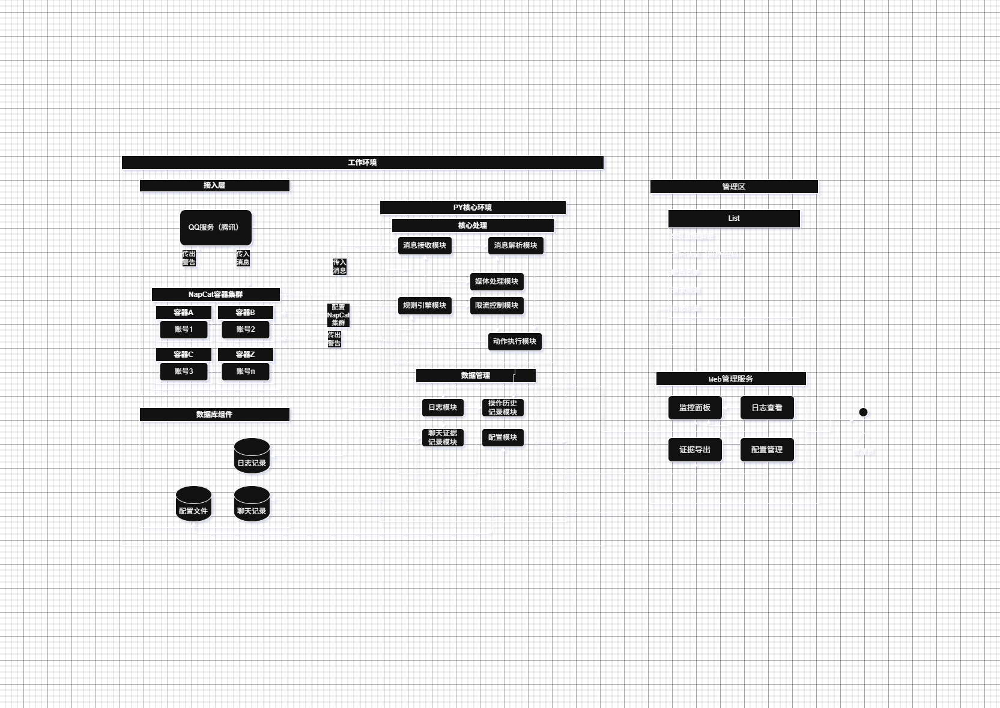

# 卧底机器人 (UndercoverBot)

> 一个用于潜伏在QQ群中监控关键词、自动预警、收集证据的机器人框架。  
> 初衷是帮助大家快速建立防线，应对网络不良信息。  
> **目前处于初期想法阶段，欢迎感兴趣的朋友一起讨论和开发！**

---

## 项目愿景

做一个**简单、易部署、可扩展**的QQ机器人，能够：

- 用多个小号潜入不同群聊，实时监控消息
- 通过关键词匹配、AI分析识别风险内容
- 自动预警（通过另一个号发送通报，多号合作）
- 收集证据（消息记录、二维码、分享链接）
- 提供Web界面管理配置和查看日志

目标是让即使不会编程的人，也能 **“点一下按钮、扫几下码登入”** 就快速搭建自己的“卧底网络”。

---

## 技术思路

我(们)会尝试基于以下成熟组件构建：

- **[Napcat](https://github.com/NapNeko/NapCatQQ)**：基于OneBot协议的QQ机器人框架，负责登录小号、收发消息。
- **Python后端**：接收Napcat上报的消息，进行逻辑处理（关键词匹配、限流、存储、调用AI等）。
- **数据库**：SQLite（轻量）/MySQL，存储消息记录、配置、证据。
- **Redis**：用于限流计数、任务队列。
- **Web管理界面**：Flask/FastAPI + 简单HTML，方便查看和管理。

**[架构简图](docs/开发指南/架构设计/整体架构.drawio)** （正在更新中...）
****

---

## 当前进展

- [x] 确认技术可行性（Napcat + Python 可实时接收/发送消息）
- [ ] 完成单账号关键词匹配原型
- [ ] 设计多账号协同方案
- [ ] 开发多账号支持、数据库存储、限流模块
- [ ] preview: 二维码识别、Web管理界面

更多细节可查看 [项目看板](https://gitee.com/ji-or-ji/Undercover-Bot/board)，当然，你也可以化身为赛博监工（[监工报表在这儿](docs/赛博监工/TODU.md)）。

---

## 如何参与

我(们)非常欢迎各种形式的贡献：

- **提出想法**：在 Issues 里告诉我(们)你想要的功能
- **代码贡献**：Fork 项目，提交 Pull Request
- **文档完善**：帮助我(们)写更易懂的文档
~~- **测试反馈**：部署试用，反馈 bug 或优化建议~~ **（目前未实现）**

### ~~开发环境准备（如果你想本地运行）~~ **（目前未实现，本条目在未来极有可能修改）**

~~1. 安装 Python 3.9+~~
~~2. 安装依赖：`pip install fastapi uvicorn httpx`~~
~~3. 下载 Napcat 并扫码登录~~
~~4. 修改 `config.py` 中的配置（群号、关键词等）~~
~~5. 运行 `python bot.py`~~

~~（详细的文档正在编写中，欢迎提前阅读）~~

---

## 交流方式

- Gitee Issues：直接在此仓库提问
- QQ群；1083803674
- 个人QQ：2406033722

---

## 开源协议

本项目采用 **GNU General Public License v3.0**，这意味着；

- 你可以自由使用、修改、分发本代码
- 但任何分发（包括修改后的版本）都必须同样采用 GPL-3.0 协议开源
- 如果你将本项目用于网络服务，建议查阅 GPL-3.0 关于聚合体的条款

**我(们)的愿景**希望这个项目能被用于保护网络环境、维护社区清朗， **而不是用于恶意攻击、侵犯隐私或任何违法违规行为**。技术本身是中立的，但使用者应有底线。愿每一位开发者都心怀善意。

---

## 特别声明

- 本项目由一名高一学生在课余时间独立开发，技术水平有限，代码并不优雅，  **架构也可能随时调整** 。
- 开发过程中会 **大量使用 AI 辅助编程** ，甚至某些模块 **可能由 AI 代劳** ，代码风格可能比较“AI味”，介意的朋友请轻拍。
- 由于学业压力，项目**可能随时暂停更新或直接崩解**，我会尽力维护。
- **请勿将本项目用于任何攻击性、违法违规或侵犯他人权益的行为**。再次强调， **技术无罪，但使用者应有底线。**
- 本项目使用了 Napcat 等第三方开源库，感谢这些项目的作者。但**本项目与这些第三方库的作者无关，任何因本项目引发的问题请勿牵连他们**，如有问题请优先在本仓库反馈。
- 如果你能接受以上“佛系”状态，欢迎一起玩耍、贡献代码或提出建议！

**让我们一起，让网络环境更清朗！**
